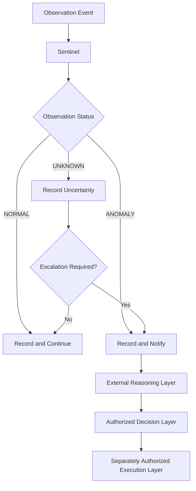

# KAZENE-Sentinel

> Observe continuously. Reason when necessary. Act only when authorized.

A minimal observation-first protocol for event-driven AI defense, separating observation, reasoning, decision-making, and execution.

## Overview

KAZENE-Sentinel is a lightweight protocol designed to determine when an observed event should be escalated to a higher-level reasoning or decision-making system.

Instead of continuously activating advanced AI reasoning, Sentinel records observations and evaluates them against predefined conditions.

Sentinel observes.
It does not autonomously intervene.

The protocol is inspired by the behavior of a trail camera: observe, record, and notify when relevant conditions are detected.

## Core Philosophy

Observation does not imply authorization.

Detection does not imply judgment.

Judgment does not imply permission to act.

KAZENE-Sentinel separates these responsibilities to reduce unnecessary reasoning, uncontrolled intervention, and authority expansion.

Its fundamental principle is:

**Observe continuously. Reason when necessary. Act only when authorized.**

## Architecture



Sentinel operates exclusively within the observation and notification boundary.

Reasoning, operational decisions, and intervention belong to separate layers.

An escalation request does not grant execution authority.

## Observation States

KAZENE-Sentinel v0.1 defines three observation states.

| State | Description |
| --- | --- |
| NORMAL | The observation satisfies predefined normal conditions. |
| ANOMALY | The observation satisfies predefined anomaly conditions. |
| UNKNOWN | The available evidence is insufficient or the observation cannot be reliably classified. |

NORMAL does not guarantee safety.

ANOMALY does not prove malicious activity.

UNKNOWN must not be silently converted into NORMAL.

These states describe observations, not definitive security judgments.

## Escalation Policy

The default escalation policy is:

| Observation State | Record | Notify | Intervention |
| --- | --- | --- | --- |
| NORMAL | Required | No | Forbidden |
| ANOMALY | Required | Yes | Forbidden |
| UNKNOWN | Required | Policy-dependent | Forbidden |

For UNKNOWN observations, escalation is determined by a predefined policy.

Sentinel must not dynamically expand its own authority or modify its escalation policy.

## Authority Boundary

Sentinel is permitted to:

- Receive observation events.
- Evaluate predefined observation conditions.
- Classify observation states.
- Record timestamps and evidence references.
- Generate escalation notifications.

Sentinel is prohibited from:

- Executing defensive or offensive actions.
- Blocking network connections.
- Modifying protected systems.
- Changing access permissions.
- Altering its own observation policy.
- Granting execution authority.
- Treating an escalation notification as authorization.

Any intervention must be handled by a separately authorized external system.

## Observation Record

An observation record contains the following elements:

| Field | Purpose |
| --- | --- |
| observation_id | Unique observation identifier |
| timestamp | Observation time in UTC |
| source | Observation source |
| status | NORMAL, ANOMALY, or UNKNOWN |
| reason | Classification reason |
| evidence | Evidence references |
| escalation_required | Whether notification is required |
| execution_authorized | Must always be false |

Example:

```json
{
  "observation_id": "OBS-002",
  "timestamp": "2026-11-24T00:00:00Z",
  "source": "synthetic-network-monitor",
  "status": "ANOMALY",
  "reason": "Predefined anomaly condition matched.",
  "evidence": [
    "synthetic-log-002"
  ],
  "escalation_required": true,
  "execution_authorized": false
}
```

This example represents synthetic observation data.

It does not represent a verified security incident.

Evidence references should avoid exposing credentials, secrets, or unnecessary personal information.

## Design Principles

### 1. Observation First

Collect and record observations before requesting advanced reasoning.

### 2. Minimum Necessary Reasoning

Advanced AI reasoning should be activated only when justified by an observation or an external policy.

### 3. Authority Separation

Observation, reasoning, decision-making, and execution must remain logically separated.

### 4. Explicit Uncertainty

Insufficient evidence must be represented as UNKNOWN rather than concealed by an artificial conclusion.

### 5. Traceability

Observations and escalation decisions should remain traceable through structured records.

### 6. No Autonomous Intervention

Sentinel must not independently intervene in the observed environment.

### 7. Controlled Expansion

Additional capabilities should be introduced only when justified by demonstrated requirements.

## Relationship to Existing Architectures

KAZENE-Sentinel is designed as a complementary observation layer rather than a complete autonomous AI system.

| Architecture | Responsibility |
| --- | --- |
| KAZENE-Sentinel | Observation and escalation |
| Reasoning Resource Governance (RRG) | Reasoning resource allocation |
| Cognitive Switchboard | Reasoning mode selection |
| Yin-Yang AI Architecture | Authority and control boundaries |
| Zero-Shutdown | Task termination and resource release |

These architectures are conceptually complementary.

No external architecture is required to validate KAZENE-Sentinel v0.1.

## Repository Structure

```text
kazene-sentinel/
├── README.md
├── specs/
│   └── sentinel-v0.1.md
├── schemas/
│   └── observation.schema.json
├── examples/
│   ├── normal.json
│   ├── anomaly.json
│   └── unknown.json
├── scripts/
│   └── validate.py
└── .github/
    └── workflows/
        └── validate.yml
```

## Validation

The planned reference validator uses Python 3.11 or later and requires no external dependencies.

Once the validator and examples are available, run:

```bash
python scripts/validate.py
```

The validator checks:

- Required observation fields.
- Supported observation states.
- Observation identifier consistency.
- UTC timestamp format.
- Escalation policy consistency.
- Explicit representation of uncertainty.
- Prohibition of execution authorization.

GitHub Actions provides automated validation of the example records.

Validation demonstrates protocol-level consistency.

It does not demonstrate real-world threat detection accuracy, operational security, or resistance to cyberattacks.

## Scope of v0.1

The initial version focuses on:

- Structured observation records.
- Three-state observation classification.
- Minimal escalation rules.
- Evidence references.
- Explicit authority boundaries.
- Synthetic examples.
- Automated consistency validation.

## Non-Goals

KAZENE-Sentinel v0.1 does not provide:

- A production-ready intrusion detection system.
- Real-time network monitoring.
- Autonomous cyber defense.
- Automated countermeasures.
- Offensive security capabilities.
- Machine learning-based anomaly detection.
- Continuous LLM inference.
- Self-modifying observation policies.
- Guaranteed threat detection.

These capabilities are intentionally outside the initial scope.

## Future Directions

Potential extensions may include:

- Standardized observation interfaces.
- Configurable escalation policies.
- Evidence integrity verification.
- Observation deduplication.
- Notification rate control.
- Distributed Sentinel nodes.
- Integration with external reasoning systems.
- Integration with reasoning resource governance.

Future extensions should be driven by demonstrated operational requirements rather than speculative complexity.

## Project Status

Version: v0.1.0 (target)

Status: Initial specification development

Implementation: Minimal reference validation (planned)

External dependencies: None planned

KAZENE-Sentinel is an experimental architectural protocol, not a certified security product.

## Closing Principle

Intelligence does not need to be continuously active.

Observation can remain lightweight.

Reasoning can remain conditional.

Execution must remain authorized.

**Sentinel observes. Intelligence responds. Authority remains bounded.**
