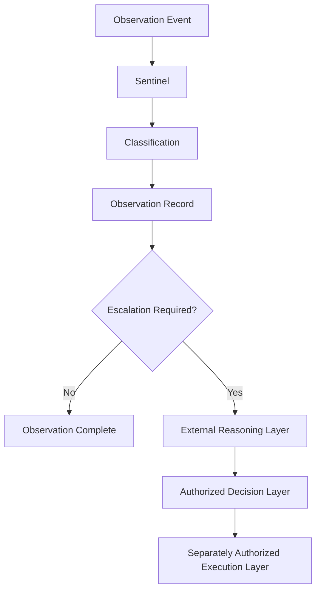
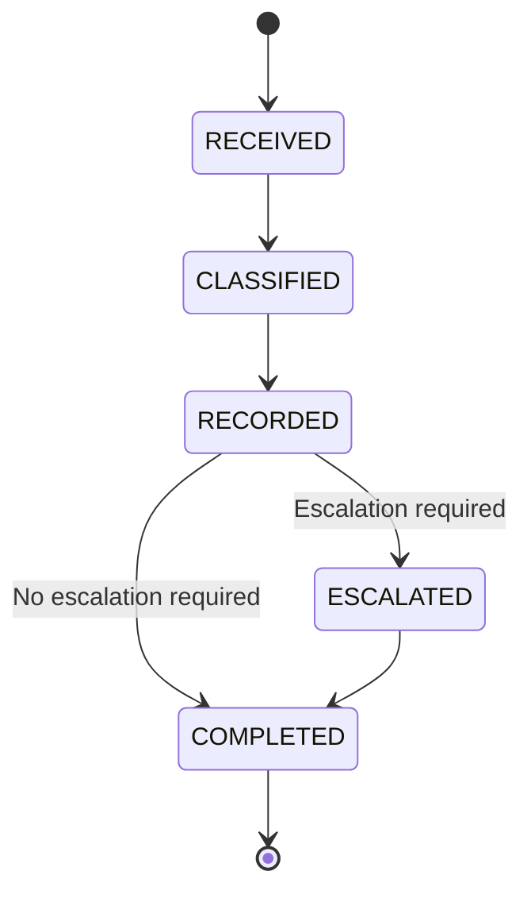

# KAZENE-Sentinel Protocol Specification v0.1

## 1. Metadata

| Item | Value |
| --- | --- |
| Protocol | KAZENE-Sentinel |
| Version | v0.1.0 |
| Status | Experimental |
| Category | Observation and Escalation Protocol |
| Architecture | Observation-First Architecture |
| Dependencies | None required |

## 2. Purpose

KAZENE-Sentinel defines a minimal protocol for separating
observation, reasoning, decision-making, and execution.

The protocol is designed to reduce unnecessary reasoning
and prevent observation systems from acquiring unauthorized
execution capabilities.

Its fundamental principle is:

> Observe continuously. Reason when necessary. Act only when authorized.

Sentinel is an observation and escalation layer.

It is not an autonomous defense system.

## 3. Normative Language

The terms MUST, MUST NOT, SHOULD, SHOULD NOT, and MAY
indicate protocol requirements and recommendations.

- MUST: Mandatory requirement.
- MUST NOT: Prohibited behavior.
- SHOULD: Recommended behavior.
- SHOULD NOT: Discouraged behavior.
- MAY: Optional behavior.

## 4. Architectural Model

KAZENE-Sentinel separates four logical layers.

| Layer | Responsibility |
| --- | --- |
| Observation | Observe, classify, record, and notify |
| Reasoning | Analyze evidence and evaluate hypotheses |
| Decision | Determine whether intervention is appropriate |
| Execution | Perform separately authorized actions |

Sentinel belongs exclusively to the Observation Layer.



The protocol does not require these layers to operate
within the same system.

An escalation notification MUST NOT be interpreted
as execution authorization.

## 5. Observation States

Every observation record MUST contain exactly one
of the following states.

### 5.1 NORMAL

The available observation satisfies predefined
normal conditions.

Requirements:

- The observation MUST be recorded.
- Escalation MUST NOT be required.
- Execution MUST NOT be authorized.

NORMAL does not guarantee that the observed
environment is safe.

### 5.2 ANOMALY

The available observation satisfies a predefined
anomaly condition.

Requirements:

- The observation MUST be recorded.
- Escalation MUST be required.
- Execution MUST NOT be authorized.

ANOMALY does not prove malicious activity,
system compromise, or hostile intent.

### 5.3 UNKNOWN

The observation cannot be reliably classified
using the available evidence and predefined conditions.

Possible causes include:

- Insufficient evidence.
- Incomplete observation.
- Unavailable data.
- Conflicting conditions.
- Undefined observation patterns.

Requirements:

- The uncertainty MUST be explicitly recorded.
- Escalation MUST follow a predefined external policy.
- Execution MUST NOT be authorized.

UNKNOWN MUST NOT be silently converted into NORMAL.

If neither NORMAL nor ANOMALY can be reliably
established, the observation MUST be classified as UNKNOWN.

## 6. Observation Lifecycle

The observation lifecycle consists of five stages.



| Stage | Description |
| --- | --- |
| RECEIVED | Observation event received |
| CLASSIFIED | Observation state determined |
| RECORDED | Structured observation record created |
| ESCALATED | Notification transferred to an external layer |
| COMPLETED | Observation processing completed |

These stages describe the logical processing lifecycle.

A COMPLETED observation does not imply that the
observed condition has been resolved.

The lifecycle MUST NOT transition directly
from observation to operational intervention.

## 7. Observation Record

Every observation record MUST contain the following fields.

| Field | Type | Required | Constraint |
| --- | --- | --- | --- |
| observation_id | string | Yes | Non-empty and unique within the validation scope |
| timestamp | string | Yes | UTC timestamp ending in Z |
| source | string | Yes | Non-empty observation source |
| status | string | Yes | NORMAL, ANOMALY, or UNKNOWN |
| reason | string | Yes | Non-empty classification reason |
| evidence | array of strings | Yes | Evidence references |
| escalation_required | boolean | Yes | Consistent with escalation rules |
| execution_authorized | boolean | Yes | MUST be false |

### 7.1 Observation Identifier

The observation_id identifies an observation record.

Identifiers MUST NOT be duplicated within the
same validation dataset.

Global identifier uniqueness is outside the scope
of v0.1.

### 7.2 Timestamp

The timestamp MUST represent a valid UTC date and time.

The supported format is:

```text
YYYY-MM-DDTHH:MM:SSZ
```

Example:

```text
2026-11-24T00:00:00Z
```

### 7.3 Source

The source identifies the system or component
from which the observation originated.

The source field MUST NOT be empty.

Source authenticity verification is outside
the scope of v0.1.

### 7.4 Classification Reason

The reason field MUST provide a non-empty
explanation of the observation classification.

For UNKNOWN observations, the reason SHOULD
identify the cause of uncertainty.

### 7.5 Evidence

Evidence MUST be represented as an array
of non-empty string references.

NORMAL and ANOMALY observations MUST contain
at least one evidence reference.

UNKNOWN observations MAY contain an empty
evidence array when evidence is unavailable.

Evidence references do not independently prove
the authenticity or integrity of the referenced data.

Credentials, secrets, and unnecessary personal
information SHOULD NOT be included.

### 7.6 Escalation Required

The escalation_required field indicates whether
an observation requires notification to an
external reasoning or decision layer.

It represents a notification requirement,
not confirmation of successful delivery.

### 7.7 Execution Authorized

The execution_authorized field MUST always
contain the boolean value false.

Any observation record containing true
MUST be rejected.

## 8. Escalation Rules

The following escalation rules are mandatory.

| Status | Record Required | Escalation Required | Execution Authorized |
| --- | --- | --- | --- |
| NORMAL | true | false | false |
| ANOMALY | true | true | false |
| UNKNOWN | true | Policy-dependent | false |

### 8.1 UNKNOWN Escalation Policy

An external policy MAY determine whether
UNKNOWN observations require escalation.

If no external policy is defined, the recommended
default is to escalate UNKNOWN observations.

Sentinel MUST NOT independently modify
its escalation policy.

In v0.1, external policy configuration and verification
are outside the scope of the reference validator.

Both true and false are structurally valid
escalation values for UNKNOWN observations.

### 8.2 Escalation Boundary

An escalation notification MAY contain
the structured observation record.

Escalation MUST NOT:

- Grant operational permissions.
- Execute defensive actions.
- Modify the observed environment.
- Override an external decision layer.
- Expand Sentinel's authority.

Notification transport, delivery confirmation,
and retry mechanisms are outside the scope of v0.1.

## 9. Authority Boundary

### 9.1 Permitted Operations

Sentinel MAY:

- Receive observation events.
- Evaluate predefined conditions.
- Classify observation states.
- Generate observation identifiers.
- Record observation timestamps.
- Record evidence references.
- Generate escalation notifications.

### 9.2 Prohibited Operations

Sentinel MUST NOT:

- Execute offensive operations.
- Execute defensive interventions.
- Block network connections.
- Modify protected systems.
- Change access permissions.
- Grant execution authority.
- Modify its own observation policy.
- Modify its own escalation policy.
- Expand its own operational authority.

### 9.3 External Authorization

Any operational intervention MUST be handled
by a separately authorized external system.

An external system MUST NOT treat the existence
of a Sentinel observation as sufficient authorization
to perform an intervention.

The authorization mechanism itself is outside
the scope of v0.1.

## 10. Reasoning Resource Policy

Sentinel SHOULD operate using lightweight,
predefined observation conditions.

Continuous advanced AI reasoning is not required.

External reasoning MAY be activated when
an escalation notification is received.

Sentinel MUST NOT require an LLM to validate
an observation record.

Reasoning budgets, model selection, and reasoning
resource allocation belong to external systems.

KAZENE-Sentinel MAY be conceptually integrated
with Reasoning Resource Governance (RRG).

Such integration is not required by v0.1.

## 11. Reference Observation

The following is a valid synthetic ANOMALY record.

```json
{
  "observation_id": "OBS-002",
  "timestamp": "2026-11-24T00:00:00Z",
  "source": "synthetic-network-monitor",
  "status": "ANOMALY",
  "reason": "Predefined anomaly condition matched.",
  "evidence": [
    "synthetic-log-002"
  ],
  "escalation_required": true,
  "execution_authorized": false
}
```

This record represents a synthetic observation.

It MUST NOT be interpreted as a verified
real-world security incident.

## 12. Validation Requirements

A conforming reference validator MUST check:

1. All required observation fields are present.
2. All field types are valid.
3. Observation identifiers are non-empty.
4. Observation identifiers are unique within the dataset.
5. Timestamps use the supported UTC format.
6. Observation sources are non-empty.
7. Observation states are supported.
8. Classification reasons are non-empty.
9. Evidence references are structurally valid.
10. NORMAL and ANOMALY contain evidence references.
11. Escalation values follow the mandatory state rules.
12. Execution authorization is always false.

The validator MUST reject records that violate
these mandatory requirements.

The reference validator MAY be implemented
using the Python standard library.

The JSON Schema and reference validator SHOULD
remain consistent with this specification.

## 13. Reference Validation Cases

The following cases define minimum expected behavior.

| Case | Status | Escalation | Execution | Result |
| --- | --- | --- | --- | --- |
| Normal observation | NORMAL | false | false | PASS |
| Anomaly observation | ANOMALY | true | false | PASS |
| Unknown with escalation | UNKNOWN | true | false | PASS |
| Unknown without escalation | UNKNOWN | false | false | PASS |
| Unnecessary normal escalation | NORMAL | true | false | FAIL |
| Missing anomaly escalation | ANOMALY | false | false | FAIL |
| Unauthorized execution | ANOMALY | true | true | FAIL |
| Unsupported state | INVALID | false | false | FAIL |
| Missing anomaly evidence | ANOMALY | true | false | FAIL |

The PASS cases assume that all other mandatory
record requirements are satisfied.

## 14. Security Considerations

KAZENE-Sentinel establishes a logical authority boundary.

A structurally valid observation record does not prove:

- That the observation source is authentic.
- That the evidence has not been modified.
- That the classification is correct.
- That escalation was successfully delivered.
- That the observed environment is secure.
- That runtime permissions enforce the declared boundary.

Production implementations require independent
security controls, including access control,
evidence protection, and runtime permission enforcement.

The execution_authorized field is a protocol invariant.

It is not a substitute for actual access control.

## 15. Non-Goals

KAZENE-Sentinel v0.1 does not define:

- Real-time network monitoring.
- Production intrusion detection.
- Automated threat response.
- Autonomous defensive intervention.
- Offensive security operations.
- Machine learning-based classification.
- Continuous LLM inference.
- Cryptographic evidence verification.
- Distributed observation consensus.
- Notification delivery guarantees.
- Self-modifying policies.

These capabilities are intentionally excluded.

## 16. Extension Policy

Future versions MAY introduce:

- Standardized observation interfaces.
- External escalation policy references.
- Evidence integrity verification.
- Observation deduplication.
- Notification rate control.
- Distributed observation nodes.
- External reasoning interfaces.
- Observation system health monitoring.

Extensions SHOULD address demonstrated requirements.

Extensions MUST preserve the separation between
observation and execution authority.

## 17. Conformance Boundary

KAZENE-Sentinel v0.1 conformance refers only
to the structural and semantic consistency
of observation records.

Passing schema validation or reference validation
does not establish operational security,
threat detection accuracy, or production readiness.

## 18. Fundamental Invariants

The following invariants define the core
of KAZENE-Sentinel.

1. Observation does not imply authorization.
2. Anomaly does not imply malicious intent.
3. Normal does not imply safety.
4. Unknown does not imply normality.
5. Escalation does not imply execution.
6. Sentinel MUST NOT expand its own authority.

## 19. Closing Principle

Observation remains lightweight.

Reasoning remains conditional.

Execution remains authorized.

> Sentinel observes.
> Intelligence responds.
> Authority remains bounded.

---

End of Specification

KAZENE-Sentinel Protocol v0.1.0
